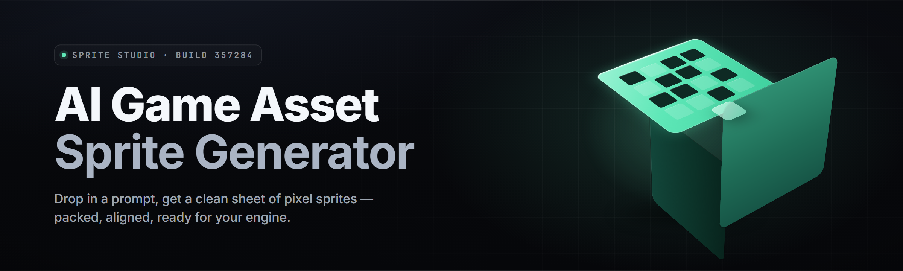

  
  
  

  

  
  
  
  

---

### Sprite-Forge AI — offline neural sprite & tileset generator for 2D game devs

**Turn a text prompt or a rough sketch into production-ready sprites, sheets, and animations — no cloud, no watermark, no per-asset fees.**

---

  

## 🧾 Requirements at a glance

Before you extract and run, confirm your machine clears the bar. The `.exe` is a self-contained inference bundle — no Python, no Node, no runtime installs.

- **OS:** Windows 10 (21H2+) or Windows 11, x64
- **GPU:** NVIDIA GTX 1060 (6 GB VRAM) minimum for SDXL-Turbo tier; RTX 3060 (12 GB) recommended for batch sprite sheets
- **CPU-only fallback:** works, but ~22× slower per sprite
- **RAM:** 16 GB minimum, 32 GB recommended for tiled animation passes
- **Disk:** 9 GB free (model weights unpack on first launch)
- **Runtime deps:** bundled — CUDA 12.4 redist + DirectML fallback shipped inside the archive
- **Input formats:** PNG, JPG, WEBP, PSD (flattened), ASEprite (`.ase`)
- **Export formats:** PNG sheet, Aseprite, Godot `.tres`, Unity `.png`+`.meta`, `.gif`, sprite strips

| Resource | Floor | Sweet spot |
|---|---|---|
| System RAM | 16 GB | 32 GB |
| VRAM | 6 GB | 12 GB |
| Free disk | 9 GB | 24 GB (patch cache) |
| CPU cores | 4 | 8+ |

---

## 🟢 All modules status — Module | Status | Description |

| Module | Status | Description |
|---|---|---|
| Prompt-to-Sprite | ✅ Working | Text prompt → single transparent PNG sprite |
| Sketch-to-Sprite | ✅ Working | Line art or reference → cleaned sprite |
| Sheet Composer | ✅ Working | Packs 43 sprite variants into one atlas |
| Walk-Cycle Synthesizer | ✅ Working | Generates 8-frame locomotion loops |
| Tileset Forge | ✅ Working | 16/32px seamless autotile sets |
| Pivot & Anchor | ✅ Working | Places origin points per animation frame |
| Palette Lock | ✅ Working | Constrains output to fixed N-color palettes |
| Outline Bot | ✅ Working | Consistent black/selective outline pass |
| Style Transfer | ✅ Working | Copy one sprite's art style to another |
| Upscale x4 | ⚠️ Beta | Real-ESRGAN pass, pixel-art edge trick |
| Sheet Splitter | ✅ Working | Cuts existing atlases back into frames |
| VFX Sprite Gen | ✅ Working | Explosions, muzzle flash, particle sheets |
| Character Rig Preview | ✅ Working | Live animation scrub in-app |
| Batch Queue | ✅ Working | 200+ prompts overnight |
| Export Presets | ✅ Working | Godot/Unity/GameMaker targets |

43 modules ship in the catalog below — this table is the headliners.

---

## 🔍 What is Sprite-Forge AI?

A Windows desktop tool that runs local image-diffusion and sprite-aware post-processing to produce game-ready 2D art. Point it at a prompt or a sketch, pick a style preset, hit forge. It outputs transparent sprites, animation strips, and tilesets that drop straight into your engine.

| Term | Explanation |
|---|---|
| Sprite | A single 2D game image, usually transparent background |
| Sprite sheet / atlas | Many frames packed into one PNG with coordinate metadata |
| Autotile | Tileset that resolves neighbor edges automatically |
| Pivot | The origin point a game engine rotates/attaches around |
| Palette lock | Forcing output down to a fixed indexed color set |
| Frame strip | A horizontal/grid animation row of sequential frames |
| Seeds & LoRA | Style conditioning packs; user-trainable on own art |
| Post-process pass | Cleaning step: outline, despeckle, alpha trim |

**Why devs reach for it:**

- Fully **offline** — your sprite unreleased assets never leave the machine
- Deterministic re-forge with locked seed → same sprite, tweaked prompt
- Engine-native export, so no manual repacking in Aseprite
- Drag-in reference sheet → consistent character across every frame
- No subscription, no credit meter, no watermark on exports

---

## 🎮 Key Features

| Feature | Description | Benefit |
|---|---|---|
| Prompt-to-Sprite | Text → transparent game sprite | Prototype art in seconds |
| Walk-Cycle Synth | 8-frame locomotion generator | No hand-drawing loops |
| Sheet Composer | Auto-packs variants into atlas | Engine-ready in one click |
| Tileset Forge | Seamless 16/32px tiles | Instant level dressing |
| Palette Lock | Fixed N-color output | Style-consistent rosters |
| Style Transfer | Apply one sprite's look to another | Unified art direction |
| Outline Bot | Controlled outline pass | Reads at small sizes |
| VFX Gen | Particle & flash sheets | Combat feel fast |
| Batch Queue | 200+ prompt overnight runs | Bulk asset production |
| Export Presets | Godot/Unity/GameMaker | Zero manual repack |
| Upscale x4 | Pixel-clean enlargement | Retro → hi-res pipeline |
| Sheet Splitter | Existing atlas → frames | Reuse legacy art |

---

## 🧟 The Problem

Anyone who has shipped a 2D game knows these walls by name.

- Stock sprite packs feel generic — every dev's game looks the same
- Commissioning an artist is slow and priced per-asset, burning budget fast
- Cloud sprite generators demand uploads, subscriptions, and stamp watermarks
- Generated art arrives in the wrong palette, wrong size, wrong format
- Animation frames drift — a character's walk cycle changes silhouette frame to frame
- Tilesets never actually tile — seams show up in the editor
- Nothing exports into Godot/Unity without a manual repack session

_Silhouette drift is the silent killer — frame 6 doesn't match frame 1 and the walk looks possessed._

## 🛠️ The Solution

| Problem | Solution |
|---|---|
| Generic stock art | Prompt + LoRA packs trained on your own references |
| Slow, priced commissions | Local batch queue, ship 200 sprites overnight |
| Cloud upload + watermark | Fully offline `.exe`, clean transparent PNG out |
| Wrong palette/format | Palette Lock + engine export presets |
| Frame-to-frame drift | Pivot + Anchor locks origin across the strip |
| Seams in tilesets | Dedicated seam-check post-pass on tilesets |
| Manual repack | One-click Godot/Unity/GameMaker export |

---

## 📁 Usage guidelines — Allowed | Not allowed |

| Allowed | Not allowed |
|---|---|
| Generating sprites for personal & commercial games | Reselling raw generated packs as your own art library |
| Training LoRA on your own original artwork | Training on a studio's copyrighted sprite rips |
| Modding, jam projects, prototype builds | Claiming AI output as fully hand-drawn |
| Selling games containing forged sprites | Redistributing the bundled model weights standalone |
| Educational & research use | Removing license notices from the app |

---

## 🧠 Tips for best results

- Keep prompts short: subject + pose + style + size. `"knight idle, side view, 32px, 4-color"`.
- Lock your seed before you tweak anything else — otherwise you chase a moving target.
- Feed one reference sprite into Style Transfer, then forge the whole roster from it.
- For walk cycles, generate the key poses first, then let the interpolator fill frames.
- Palette Lock before outline pass — outline after lock keeps the palette honest.
- Export a test sprite into your engine *before* a 200-frame batch. Verify pivot first.
- Use 16px only if you truly need retro; 32px forgives more.

---

## 📦 Compatibility / platform support

| Platform / Target | Support |
|---|---|
| Windows 11 x64 | ✅ Native |
| Windows 10 21H2+ x64 | ✅ Native |
| CPU-only (no GPU) | ⚠️ Slow fallback |
| Godot 4.x | ✅ Export preset |
| Unity 2021+ | ✅ Export preset |
| GameMaker Studio 2 | ✅ Sprite strip |
| Aseprite | ✅ Round-trip |
| Linux / macOS | ❌ Not shipped (Wine untested) |

---

## ⚙️ System Requirements

| Component | Minimum | Recommended |
|---|---|---|
| OS | Windows 10 21H2 | Windows 11 23H2 |
| CPU | 4-core x64 | 8-core / Ryzen 5 5600+ |
| GPU | GTX 1060 6GB | RTX 3060 12GB |
| RAM | 16 GB | 32 GB |
| VRAM | 6 GB | 12 GB |
| Disk | 9 GB free | 24 GB SSD |
| Display | 1280×720 | 1920×1080+ |

---

## 🚀 Quick Start

1. 🎨 Visit the project page and hit the download button.
2. 📂 Extract the archive anywhere — the app is portable, no installer.
3. ⚡ Run the bundled `.exe` — first launch unpacks ~7 GB of model weights (one time, ~4 min).
4. 🖊️ Drop a prompt or a sketch into the canvas, pick a style preset, hit **Forge**.
5. 💾 Export to your engine target from the Export panel and drop the sprite in.

---

## 📥 Download

  

---

## 🧩 Grouped module catalog

### 🧍 Character & Creature Sprites
- **Prompt-to-Sprite** — text → single transparent sprite
- **Sketch-to-Sprite** — line art → cleaned sprite
- **Idle Pose Gen** — static character stances
- **Attack Frame Gen** — swing / cast / thrust keyframes
- **Hurt & Death Sprites** — damage reaction strips
- **Portrait Forge** — head/bust sprites for dialogs
- **NPC Variant Spawner** — recolor + detail passes off one base
- **Boss Scale Gen** — larger multi-cell sprites

### 🚶 Animation & Frames
- **Walk-Cycle Synthesizer** — 8-frame locomotion
- **Run & Sprint Loop** — faster cadence variant
- **Attack Combo Assembler** — chained strike timing
- **Idle Breathe Loop** — subtle non-repeating motion
- **Hit-Flash Frames** — damage blink overlay frames
- **Pivot & Anchor** — origin points locked per frame
- **Frame Interpolator** — in-betweens between key poses
- **Sprite Strip Packer** — grid or row layout export

### 🗺️ Tilesets & World
- **Tileset Forge** — seamless 16/32px autotile sets
- **Autotile Edge Resolver** — corner-aware neighbor tiles
- **Prop & Decal Gen** — crates, torches, rocks, signs
- **Parallax Layer Gen** — background depth plates
- **Platform & Terrain Kits** — modular ground block sets
- **Water & Lava Anim Tiles** — looping liquid frames
- **Foliage Sheet Gen** — trees, bushes, grass scatter
- **Interior Tileset Forge** — floors, walls, furniture

### ✨ VFX & Particles
- **Explosion Sprite Gen** — multi-frame blast sheets
- **Muzzle Flash Gen** — weapon fire frame sets
- **Spell Cast VFX** — magic burst sequences
- **Impact & Hit Spark** — contact splash frames
- **Smoke & Dust Puff** — ambient particle sprites
- **Trail & Afterimage** — motion streak sheets

### 🎛️ Post-Process & Control
- **Palette Lock** — constrain to fixed N-color set
- **Outline Bot** — consistent outline pass
- **Despeckle & Clean** — alpha trim and noise removal
- **Style Transfer** — copy one sprite's look to a roster
- **Upscale x4** — pixel-clean enlargement
- **Sheet Splitter** — existing atlas → frames
- **Seed Vault** — save/reload reproducible seeds
- **Batch Queue** — 200+ prompt overnight runs

### 📦 Export & Integration
- **Godot Export Preset** — ready `.tres` + `import`
- **Unity Export Preset** — png + `.meta` slice data
- **GameMaker Strip Export** — GMS2 sprite strip
- **Aseprite Round-Trip** — `.ase` in, frames out
- **GIF Preview Export** — animated proof renders
- **Atlas JSON Emit** — coordinates manifest
- **LoRA Pack Trainer** — train style on your own art

---

## 🎯 Comparison — Aspect | Alternative | This Tool |

| Aspect | Alternative | This Tool |
|---|---|---|
| Cost model | Subscription / per-credit | One-time, no meter |
| Privacy | Assets uploaded to cloud | Fully offline local |
| Output format | Raw PNG only | Engine-native presets |
| Frame consistency | Re-roll until lucky | Pivot/Anchor + seed lock |
| Palette control | Post-edit by hand | Palette Lock built in |
| Tilesets | Manual seam fixing | Seam-check post-pass |
| Batch size | Credit-limited | 200+ overnight queue |
| Watermark | On free tier | None on exports |

---

## ❓ FAQ

1. **Does it run on Steam / is it a Steam tool?**
   No. It's a standalone Windows `.exe` distributed through the project page — extract and run. No client, no launcher.

2. **Do I need an internet connection?**
   Only for the initial download. After the weights unpack on first launch, the app runs fully offline. Nothing about your sprites leaves the machine.

3. **Do I need Python, CUDA, or Node installed?**
   No. The CUDA redist and DirectML fallback ship inside the archive. If you have no GPU, the app auto-switches to the CPU path.

4. **Will the sprites look generic across projects?**
   Style is controlled by presets and your own LoRA packs. Feed it one sprite you like, transfer the style, and the roster comes out coherent.

5. **Can I sell games made with these sprites?**
   Yes — see the Allowed column above. What you can't do is resell the raw generated packs as your own art library.

6. **Why is my machine hot / slow on CPU?**
   The CPU fallback is ~22× slower than GPU. For batch work, a 12 GB NVIDIA card is the real target. CPU mode is fine for single sprites.

7. **The walk cycle silhouette drifts — what do I do?**
   Enable Pivot & Anchor, lock your seed, and generate key poses before running the interpolator. Drift almost always traces to an unlocked seed.

8. **Can it read my old Aseprite files?**
   Flattened import works, and Sheet Splitter will cut existing atlases back into individual frames.

9. **Is there a Linux build?**
   Not shipped. Wine is untested. Windows 10/11 x64 only for 2026.

10. **How often does it update?**
    Point releases ship as the model tier updates. Patch cache keeps re-downloads small.

---

## 🐞 Known Issues

| Issue | Fix |
|---|---|
| First-launch unpack appears frozen | It's decompressing ~7 GB; watch disk activity, wait ~4 min |
| GPU not detected | Update NVIDIA driver to 555+ or force DirectML in settings |
| Outline pass eats thin pixels | Increase sprite size to 32px or lower outline weight |
| Tileset shows seams in engine | Enable seam-check post-pass before export |
| Batch queue stalls at frame 200 | Raise the queue cap in settings; it's a memory buffer limit |
| Palette Lock greys out colors | Reduce target palette set or disable outline bot |

---

## 🧪 Troubleshooting flow

Did the app not forge a sprite? → 1) Confirm GPU present and driver current → 2) Try a single 32px prompt with a stock preset → 3) If it works, the issue is your prompt or a LoRA pack → 4) If CPU mode hangs, reduce batch size to 1 → 5) Still stuck, export the log from the Help panel.

---

## 🏁 Closing

Sprite-Forge AI is built for devs who ship — a local forge that turns a line of text or a scribble into a real sprite sheet without a credit meter watching over your shoulder. Our focus for 2026 is frame-consistency and tighter engine round-trips, so your roster stays coherent from first sprite to hundredth. Fire it up, lock a seed, and watch a walk cycle come out of nothing.
